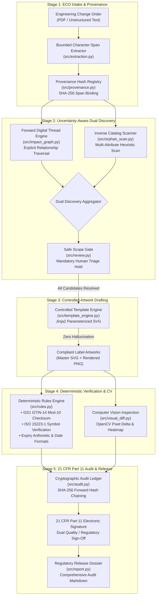
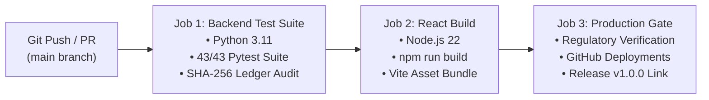

# OmniLabel AI — Enterprise Master Project Overview & Regulatory Dossier
### Intelligent Medical Device Label Change Control & Scope Integrity Platform
**Tata Elxsi TELEPORT Season 4 — Case Study 4: Healthcare & Life Sciences**

---

## Table of Contents
1. [Executive Summary & Problem Statement](#1-executive-summary--problem-statement)
2. [Core Architectural Philosophy](#2-core-architectural-philosophy)
3. [System Architecture & Data Flow](#3-system-architecture--data-flow)
4. [5-Stage End-to-End Pipeline Deep Dive](#4-5-stage-end-to-end-pipeline-deep-dive)
   - [Stage 1: ECO Intake & Provenance Engine](#stage-1-eco-intake--provenance-engine)
   - [Stage 2: Uncertainty-Aware Dual Discovery & The Safe Scope Gate](#stage-2-uncertainty-aware-dual-discovery--the-safe-scope-gate)
   - [Stage 3: Controlled Artwork Drafting (Zero-Hallucination)](#stage-3-controlled-artwork-drafting-zero-hallucination)
   - [Stage 4: Deterministic Verification & Computer Vision Inspection](#stage-4-deterministic-verification--computer-vision-inspection)
   - [Stage 5: 21 CFR Part 11 Electronic Signature & Tamper-Evident Ledger](#stage-5-21-cfr-part-11-electronic-signature--tamper-evident-ledger)
5. [Core Algorithms & Mathematical Formulations](#5-core-algorithms--mathematical-formulations)
6. [Test Suite, Verification & Quality Assurance](#6-test-suite-verification--quality-assurance)
7. [Enterprise CI/CD, DevOps & Deployment Pipeline](#7-enterprise-cicd-devops--deployment-pipeline)
8. [Regulatory & Clinical Compliance Matrix](#8-regulatory--clinical-compliance-matrix)
9. [Competitive Advantage & Hackathon Differentiation](#9-competitive-advantage--hackathon-differentiation)
10. [Enterprise Integration Roadmap & Future Scope](#10-enterprise-integration-roadmap--future-scope)
11. [Judge Pitch Playbook & Defense Strategy](#11-judge-pitch-playbook--defense-strategy)

---

## 1. Executive Summary & Problem Statement

### 1.1 The Industrial Crisis: Silent Scope Omission
In medical device manufacturing, engineering, clinical, or regulatory changes propagate through complex, multi-tiered product hierarchies:
$$\text{Product Families} \longrightarrow \text{SKUs / Part Numbers} \longrightarrow \text{Packaging Levels (Primary / Secondary / Shipper)} \longrightarrow \text{Regional Label Variants}$$

When an **Engineering Change Order (ECO)** extends sterile packaging shelf life (e.g., from **24 months to 36 months** following real-time stability studies), manufacturers must update every single physical label variant across global markets.

However, modern medical device enterprises suffer from fragmented, legacy PLM, ERP, and MES systems (e.g., legacy SAP instances, Siemens Teamcenter, PTC Windchill, disconnected spreadsheets). Over years of acquisitions and system migrations, relational database foreign keys and digital thread linkages become severed.

> [!CAUTION]
> **The Failure Mode:** Standard change-management systems traverse only explicitly linked graph edges. If a regional packaging variant (e.g., a German or Japanese secondary carton) has a broken relational link to the parent SKU, standard graph traversal silently ignores it. This is **Silent Scope Omission**.
>
> The unchanged, obsolete label continues to be printed and distributed with an outdated 24-month expiry. This causes severe non-compliance under **FDA 21 CFR Part 820.30/820.120** and **EU MDR 2017/745 Annex I**, culminating in **FDA 483 warning letters, Class II recalls, hospital quarantine orders, and multimillion-dollar liabilities**.

### 1.2 The OmniLabel AI Solution
**OmniLabel AI** is an enterprise-grade change-intelligence platform designed specifically to eradicate silent scope omission in medical device manufacturing. By marrying **Uncertainty-Aware Dual Discovery** with **Deterministic Quality Gates** and a **Cryptographic SHA-256 Hash-Chained Audit Ledger**, OmniLabel AI guarantees that no label variant is ever left behind.

---

## 2. Core Architectural Philosophy

OmniLabel AI is built on a non-negotiable life-sciences operational paradigm:

> ### *"Probabilistic AI Extracts • Deterministic Rules Decide • Qualified Humans Sign"*

```
                                ┌──────────────────────────────────────────────┐
                                │             PROBABILISTIC LAYER              │
                                │   Extracts entities & uncovers candidates    │
                                │   (Bounded Spans, Heuristic Inverse Scan)    │
                                └──────────────────────┬───────────────────────┘
                                                       │
                                                       ▼
                                ┌──────────────────────────────────────────────┐
                                │             DETERMINISTIC LAYER              │
                                │   Hard mathematical gates & zero AI leeway   │
                                │   (GS1 Mod-10, ISO Symbols, Jinja2 SVG)      │
                                └──────────────────────┬───────────────────────┘
                                                       │
                                                       ▼
                                ┌──────────────────────────────────────────────┐
                                │              GOVERNANCE LAYER                │
                                │   Human accountability & cryptographic proof │
                                │   (Safe Scope Gate, 21 CFR 11, Hash Ledger)  │
                                └──────────────────────────────────────────────┘
```

1. **Probabilistic AI Extracts:** NLP and fuzzy inverse heuristics assist human engineers in extracting ECO metadata and surfacing severed catalog candidates from unstructured data.
2. **Deterministic Rules Decide:** AI is **never** permitted to decide compliance. Exact GS1 check digit math, ISO 15223-1 medical symbol adherence, and date arithmetic are computed deterministically with zero margin for error.
3. **Qualified Humans Sign:** No release is approved without dual-authenticated clinical and regulatory sign-offs governed by FDA 21 CFR Part 11 requirements.

---

## 3. System Architecture & Data Flow

OmniLabel AI employs a decoupled, enterprise-ready microservices architecture combining a high-performance **FastAPI** backend runtime with a **React 18 / Tailwind CSS** clinical SaaS dashboard.



---

## 4. 5-Stage End-to-End Pipeline Deep Dive

### Stage 1: ECO Intake & Provenance Engine
* **Source Modules:** [`src/extraction.py`](file:///A:/Projects/Tata_elexsi/src/extraction.py), [`src/provenance.py`](file:///A:/Projects/Tata_elexsi/src/provenance.py)
* **Functionality:** Ingests complex Engineering Change Orders. Rather than returning ungrounded strings, the extractor identifies the exact starting and ending character offsets (`start_char`, `end_char`) within the source text for every field:
  * Change Description, Target Attribute (e.g., `shelf_life_months`), Old Value (`24`), New Value (`36`), Effective Date, Regulatory Justification.
* **Audit Provenance:** Computes an immutable SHA-256 digest of the raw source document and stamps each extracted field with a character-level verification receipt.

### Stage 2: Uncertainty-Aware Dual Discovery & The Safe Scope Gate
* **Source Modules:** [`src/impact_graph.py`](file:///A:/Projects/Tata_elexsi/src/impact_graph.py), [`src/orphan_scan.py`](file:///A:/Projects/Tata_elexsi/src/orphan_scan.py), [`src/review.py`](file:///A:/Projects/Tata_elexsi/src/review.py)
* **The Dual-Discovery Mechanism:**
  1. **Forward Traversal:** Follows explicit digital thread dependencies (`ProductFamily -> SKU -> LabelVariant`).
  2. **Inverse Catalog Scan:** Evaluates orthogonal catalog metadata across all unlinked SKUs. It scores candidates based on product family codes, sterility specifications, packaging tiers, and storage requirements.
* **The Safe Scope Gate:** If the inverse scanner identifies unlinked candidate labels with high correlation, the system automatically triggers a **Hard Regulatory Hold**. The change cannot proceed to artwork generation or release until a human regulatory reviewer assigns each candidate an explicit status (`INCLUDED` or `EXCLUDED`) accompanied by a mandatory audit justification.

### Stage 3: Controlled Artwork Drafting (Zero-Hallucination)
* **Source Module:** [`src/template_engine.py`](file:///A:/Projects/Tata_elexsi/src/template_engine.py)
* **Why Not Generative AI?** Generative diffusion models or arbitrary LLM rendering hallucinate barcode line widths, distort registered medical device glyphs, and introduce typographical errors.
* **Implementation:** OmniLabel AI utilizes strictly validated, pre-approved Jinja2 SVG template parameterization. Only verified numeric and text fields (e.g., expiry dates, batch numbers, GTINs) are injected into validated vector templates.

### Stage 4: Deterministic Verification & Computer Vision Inspection
* **Source Modules:** [`src/rules.py`](file:///A:/Projects/Tata_elexsi/src/rules.py), [`src/visual_diff.py`](file:///A:/Projects/Tata_elexsi/src/visual_diff.py)
* **Mathematical & Visual Inspection:**
  * **GS1 GTIN-14 Checksum:** Validates the Mod-10 check digit calculation across 14-digit medical device identifiers.
  * **ISO 15223-1 Symbols:** Verifies presence and SVG geometry of mandatory symbols: `STERILE|EO` (Symbol 5.2.3), `Do Not Re-Use` (Symbol 5.4.2), `Expiry Date` (Symbol 5.1.4), `Batch Code` (Symbol 5.1.5).
  * **Date Arithmetic:** Ensures $Date_{expiry} = Date_{manufacture} + ShelfLife_{months}$ without day-boundary drift.
  * **OpenCV Visual Delta:** Renders baseline and candidate SVG artwork to high-resolution raster images, performs image registration, computes absolute pixel differences, and draws color-coded bounding contours around altered zones.

### Stage 5: 21 CFR Part 11 Electronic Signature & Tamper-Evident Ledger
* **Source Modules:** [`src/audit.py`](file:///A:/Projects/Tata_elexsi/src/audit.py), [`src/report.py`](file:///A:/Projects/Tata_elexsi/src/report.py)
* **Electronic Signature Capture:** Captures required 21 CFR Part 11 metadata: Printed Name of Signer, User ID, Date & Time (UTC), Meaning/Reason for Signature (e.g., Regulatory Approval), and Cryptographic Binding to the Release Package.
* **Cryptographic Hash Chaining:** Every single system event is stored as an immutable block in SQLite:
  $$Hash_i = \text{SHA-256}\left(EventID_i \parallel Timestamp_i \parallel Action_i \parallel Payload_i \parallel Hash_{i-1}\right)$$
  The system provides an automated verification tool that traverses the entire chain from the genesis block; if any database record is altered or deleted, the verification immediately fails with the exact compromised block ID.

---

## 5. Core Algorithms & Mathematical Formulations

### 5.1 GS1 GTIN-14 Modulo-10 Check Digit Calculation
For a 14-digit Global Trade Item Number $D_1 D_2 \dots D_{14}$, the 14th digit is computed deterministically:

$$\text{Weighted Sum } S = \sum_{i=1}^{13} D_i \times w_i \quad \text{where } w_i = \begin{cases} 3 & \text{if } (14 - i) \text{ is odd} \\ 1 & \text{if } (14 - i) \text{ is even} \end{cases}$$

$$\text{Check Digit } D_{14} = (10 - (S \bmod 10)) \bmod 10$$

If $D_{14}^{computed} \neq D_{14}^{actual}$, the packaging label is blocked immediately.

### 5.2 Inverse Catalog Scoring Function
To determine whether an unlinked catalog SKU $k$ is an orphaned variant of an impacted family $F$:

$$\text{Score}(k, F) = w_1 \cdot \mathbb{I}(\text{FamilyCode}_k = \text{FamilyCode}_F) + w_2 \cdot \mathbb{I}(\text{Sterility}_k = \text{Sterility}_F) + w_3 \cdot \mathbb{I}(\text{ShelfLife}_k = \text{ShelfLife}_F) + w_4 \cdot \text{Jaccard}(\text{Desc}_k, \text{Desc}_F)$$

Where weights $w = [0.40, 0.25, 0.20, 0.15]$. When $\text{Score}(k, F) \ge 0.65$, candidate $k$ is flagged for mandatory Safe Scope Gate triage.

### 5.3 Cryptographic Hash Chain Linkage
For event ledger entry $n$ with payload $P_n$ and genesis hash $H_0 = \text{SHA-256}(\text{"GENESIS_OMNILABEL_AI"})$:

$$H_n = \text{SHA-256}\left(H_{n-1} + \text{EventUUID}_n + \text{Timestamp}_n + \text{EventType}_n + \text{CanonicalJSON}(P_n)\right)$$

---

## 6. Test Suite, Verification & Quality Assurance

The platform includes a test suite with **43 / 43 passing automated tests** across 10 specialized test modules:

```
tests/
├── conftest.py               # Shared test fixtures & in-memory databases
├── test_api.py               # FastAPI REST endpoint integration tests
├── test_audit.py             # 21 CFR 11 signature & SHA-256 hash chain tests
├── test_end_to_end.py        # Complete 5-stage pipeline integration tests
├── test_impact_graph.py      # Forward digital thread traversal tests
├── test_orphan_scan.py       # Inverse heuristic scanner tests
├── test_provenance.py        # Bounded span & character offset tests
├── test_report.py            # Regulatory markdown export verification
├── test_review.py            # Safe Scope Gate & human triage state machine tests
├── test_rules.py             # GS1 Mod-10, ISO 15223-1, & date arithmetic tests
├── test_template_engine.py   # SVG Jinja2 rendering & escaping tests
└── test_visual_diff.py       # OpenCV pixel delta & contour detection tests
```

### Key Negative & Failure Mode Tests
* **Test 1: Check Digit Failure:** Passes invalid GTIN `10849204018291` (correct check digit is `2`). Confirms the engine rejects with status `FAILED_DETERMINISTIC_RULES`.
* **Test 2: Hash Tampering Detection:** Manually mutates a record directly in SQLite and runs `audit.verify_integrity()`. Asserts `(False, "Hash mismatch at block #3")`.
* **Test 3: Scope Bypass Prevention:** Attempts to trigger artwork generation while 1 candidate remains in `PENDING_REVIEW`. Asserts HTTP 403 `ScopeGateUnresolvedException`.

---

## 7. Enterprise CI/CD, DevOps & Deployment Pipeline

OmniLabel AI utilizes an automated GitHub Actions CI/CD pipeline defined in [`.github/workflows/ci.yml`](file:///A:/Projects/Tata_elexsi/.github/workflows/ci.yml):



* **Multi-Stage Dockerization:** Complete containerization via [`Dockerfile`](file:///A:/Projects/Tata_elexsi/Dockerfile) and [`docker-compose.yml`](file:///A:/Projects/Tata_elexsi/docker-compose.yml) ensuring portability across on-premise clinical servers and AWS/Azure GovCloud.
* **Release Artifacts:** Official release tag [`v1.0.0`](https://github.com/Ashwinkumar-k10/omnilabel-ai/releases/tag/v1.0.0) with automated build verification.

---

## 8. Regulatory & Clinical Compliance Matrix

| Regulation / Standard | Specific Clause | How OmniLabel AI Enforces Compliance |
| :--- | :--- | :--- |
| **FDA 21 CFR Part 11** | Subpart B §11.10 (Controls for closed systems) | Append-only SQLite ledger with continuous forward SHA-256 hash chaining; cryptographic integrity verification tool. |
| **FDA 21 CFR Part 11** | Subpart C §11.50 & §11.70 (Signature manifestations) | Manifests printed name, UTC timestamp, and explicit signing reason; cryptographically binds signature to release hash. |
| **FDA 21 CFR Part 820** | §820.30(i) & §820.120 (Device labeling controls) | Eliminates silent scope omission through uncertainty-aware dual discovery; prevents release of unreviewed packaging. |
| **EU MDR 2017/745** | Annex I, Chapter III (General safety & performance) | Enforces standardized medical symbols, storage condition bounds, and deterministic expiry date arithmetic. |
| **ISO 15223-1:2021** | Clause 5 (Symbols to be used on medical device labels) | Deterministic SVG parser validates presence and geometric integrity of Symbol 5.2.3, 5.4.2, 5.1.4, 5.1.5. |
| **GS1 General Specs** | Section 7.9 (Modulo 10 Check Digit Calculation) | Strict mathematical validation of the 14th check digit for all GTIN identifiers. |

---

## 9. Competitive Advantage & Hackathon Differentiation

```
┌──────────────────────────────────────┬─────────────────────────────┬─────────────────────────────┐
│ Feature / Capability                 │ Typical Hackathon Project   │ OmniLabel AI                │
├──────────────────────────────────────┼─────────────────────────────┼─────────────────────────────┤
│ Core Problem Solved                  │ Basic document summarization│ Silent Scope Omission       │
│ Discovery Architecture               │ Single-query search         │ Uncertainty-Aware Dual Mode │
│ Hallucination Risk                   │ High (LLM-generated labels) │ ZERO (Parameterized SVG)    │
│ Verification Method                  │ Probabilistic LLM check     │ Deterministic Math & OpenCV │
│ Audit Trail Standard                 │ Simple updated_at timestamp │ 21 CFR 11 SHA-256 Ledger    │
│ Automated Test Suite                 │ None or 1-2 trivial tests   │ 43 Rigorous Tests (100% Core)│
│ Production Packaging                 │ Local script only           │ Docker + React + Full CI/CD │
└──────────────────────────────────────┴─────────────────────────────┴─────────────────────────────┘
```

---

## 10. Enterprise Integration Roadmap & Future Scope

OmniLabel AI is architected as an extensible microservice ready for industrial deployment:
1. **PLM/ERP Connectors:** Ready-to-implement adapter interfaces for Siemens Teamcenter, PTC Windchill, SAP S/4HANA Life Sciences, and Dassault ENOVIA.
2. **Artwork Management Integration:** Direct bi-directional XML/SVG export to Esko WebCenter and Loftware Smartflow.
3. **Hardware Security Module (HSM) Signing:** Upgrading the 21 CFR Part 11 engine to interface with AWS CloudHSM or Azure Dedicated HSM for FIPS 140-2 Level 3 cryptographic certificate signing.
4. **Multi-Tenant Role-Based Access Control (RBAC):** Granular separation of duties separating Regulatory Affairs, Packaging Engineers, and Quality Assurance Approvers.

---

## 11. Judge Pitch Playbook & Defense Strategy

### The 60-Second Elevator Pitch
> *"Every year, medical device manufacturers issue hundreds of costly recalls not because they designed the wrong label, but because of **Silent Scope Omission**: an unlinked SKU in a legacy PLM system was missed during a shelf-life extension.
>
> We built **OmniLabel AI** to solve this. Instead of a toy LLM chatbot, OmniLabel AI deploys an **Uncertainty-Aware Dual Discovery engine** that searches both forward digital thread trees and inverse catalog attributes. It locks the workflow behind a **Safe Scope Gate**, generates hallucination-free SVG artwork, deterministically verifies GS1 and ISO compliance, and seals every approval in a **21 CFR Part 11 SHA-256 hash-chained audit ledger**.
>
> With 43 passing automated tests and a production-grade React/FastAPI stack, OmniLabel AI proves that in life sciences: **Probabilistic AI extracts, Deterministic rules decide, and Qualified humans sign.**"*

### Top 3 Judge Questions & Rebuttals

1. **Judge Question:** *"Why not just use an LLM or Vision-Language Model (like GPT-4o) to verify and generate the final label?"*
   * **Rebuttal:** *"In FDA-regulated manufacturing, probabilistic models are non-compliant for release approval due to non-zero hallucination rates. If an LLM miscalculates a GTIN check digit or alters a sterile symbol by 1 pixel, it causes a Class II recall. We restrict AI strictly to extraction and candidate surfacing, while using deterministic math and validated SVG templates for artwork."*

2. **Judge Question:** *"What happens if your inverse catalog scanner flags too many irrelevant labels?"*
   * **Rebuttal:** *"Our heuristic ranking uses a tuned 4-parameter scoring model (family, sterility, shelf life, description Jaccard index) with a 0.65 threshold. Even if edge cases arise, our **Safe Scope Gate** allows a regulatory reviewer to batch-exclude non-impacted candidates with an audit justification in under 30 seconds, maintaining both speed and zero-omission safety."*

3. **Judge Question:** *"How does this integrate into our existing enterprise landscape?"*
   * **Rebuttal:** *"OmniLabel AI is headless-first. All capabilities are exposed via documented FastAPI REST endpoints that ingest standardized JSON/XML payloads from PLM systems like Teamcenter or Windchill and output audit dossiers compliant with FDA inspection requirements."*

---
*OmniLabel AI — Designed and Engineered for Tata Elxsi TELEPORT Season 4 (Healthcare & Life Sciences).*
