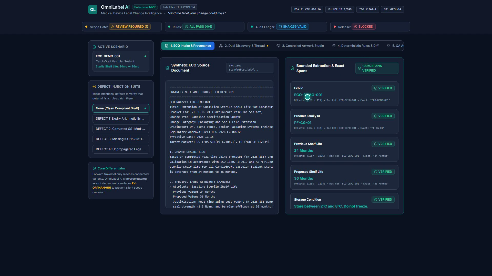
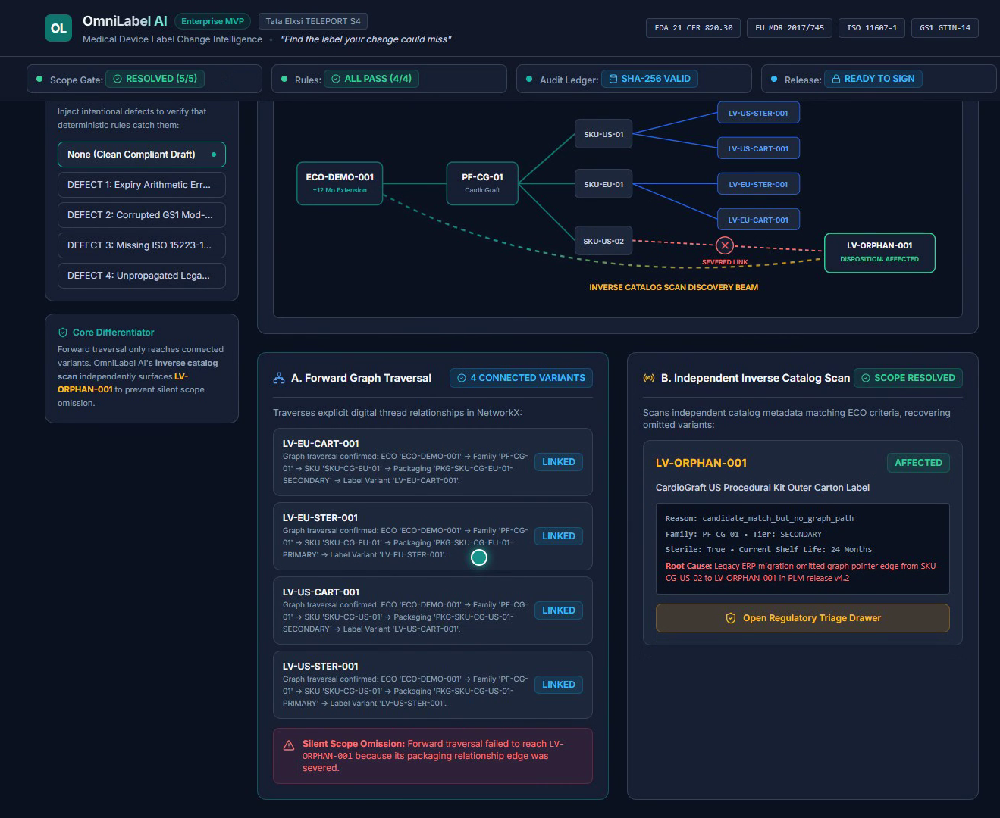
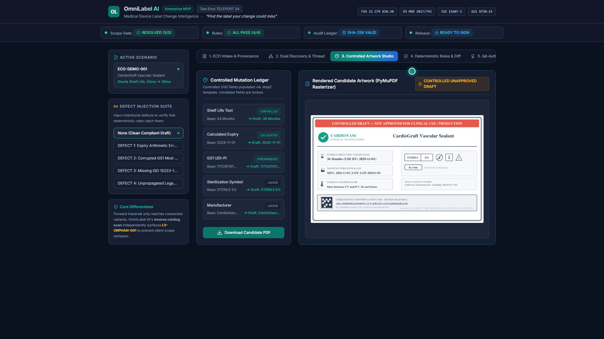
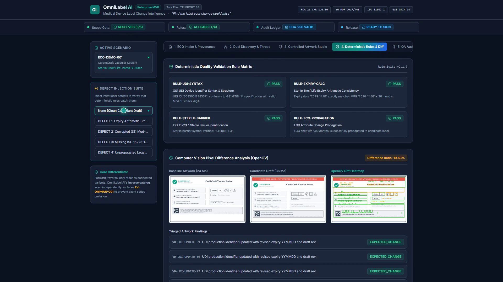
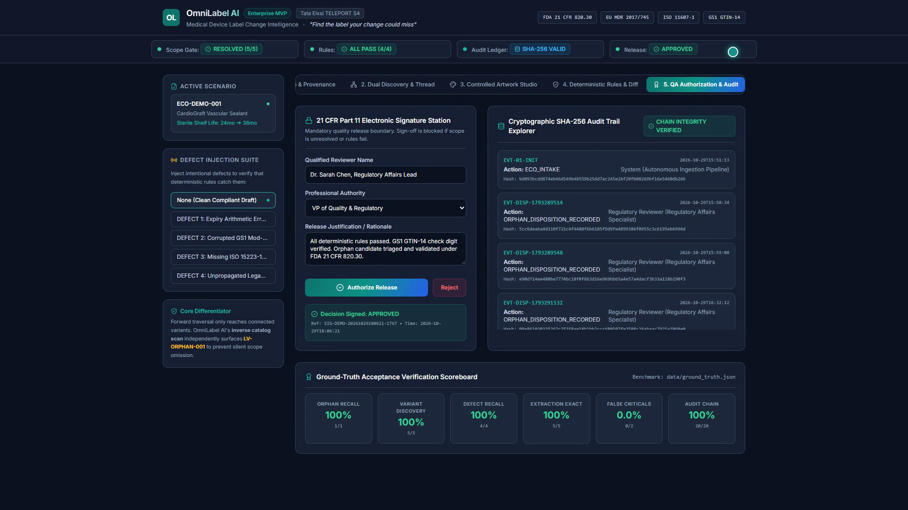

# OmniLabel AI
### Enterprise Medical Device Label Change Intelligence Platform
**Tata Elxsi TELEPORT Season 4 — Case Study 4: Healthcare & Life Sciences**

[](https://github.com/Ashwinkumar-k10/omnilabel-ai/actions)
[](https://github.com/Ashwinkumar-k10/omnilabel-ai/releases)
[](https://github.com/Ashwinkumar-k10/omnilabel-ai/actions)
[](https://github.com/Ashwinkumar-k10/omnilabel-ai)
[](https://github.com/Ashwinkumar-k10/omnilabel-ai)
[](LICENSE)

> **Core Operating Principle:**  
> *Probabilistic AI Extracts • Deterministic Rules Decide • Qualified Humans Sign*
>
> **Core Differentiator:**  
> *Find the label your change could miss.*

---

## 📑 Table of Contents
1. [Executive Summary & Problem Statement](#1-executive-summary--problem-statement)
2. [State-of-the-Art (SOTA) Competitive Comparison](#2-state-of-the-art-sota-competitive-comparison)
3. [System Architecture & Visual Pipeline](#3-system-architecture--visual-pipeline)
4. [5-Stage Clinical Pipeline UI Gallery](#4-5-stage-clinical-pipeline-ui-gallery)
5. [Deterministic Mathematics & Algorithms](#5-deterministic-mathematics--algorithms)
6. [Regulatory & Clinical Compliance Matrix](#6-regulatory--clinical-compliance-matrix)
7. [Technology Stack](#7-technology-stack)
8. [Repository Structure](#8-repository-structure)
9. [Verified Ground-Truth Performance Metrics](#9-verified-ground-truth-performance-metrics)
10. [Quick Start & Step-by-Step Execution](#10-quick-start--step-by-step-execution)
11. [FastAPI REST API Reference](#11-fastapi-rest-api-reference)
12. [Enterprise CI/CD & Cryptographic Assurance](#12-enterprise-cicd--cryptographic-assurance)
13. [Regulatory Disclaimer & License](#13-regulatory-disclaimer--license)

---

## 1. Executive Summary & Problem Statement

### 1.1 The Industrial Crisis: Silent Scope Omission
In medical device manufacturing, engineering, clinical, or regulatory changes propagate through complex multi-tiered product hierarchies:

```text
┌──────────────────┐     ┌─────────────────────┐     ┌────────────────────────┐     ┌────────────────────────┐
│ Product Families │ ──► │ SKUs / Part Numbers │ ──► │ Packaging Tiers (1/2/3)│ ──► │ Regional Label Variants│
└──────────────────┘     └─────────────────────┘     └────────────────────────┘     └────────────────────────┘
```

When an **Engineering Change Order (ECO)** extends sterile packaging shelf life (e.g., from **24 months to 36 months** following real-time stability testing), manufacturers must update every physical packaging variant across global markets.

However, medical device enterprises operate on fragmented, legacy PLM, ERP, and MES systems (legacy SAP, Siemens Teamcenter, PTC Windchill, Excel sheets). Over decades of migrations, foreign keys and digital thread links become disconnected.

> [!CAUTION]
> **The Catastrophic Failure Mode:** Standard change-management tools only traverse explicitly linked parent-child graph edges. If a regional packaging variant (e.g., a German or Japanese secondary carton) has a broken relational link to the parent SKU, standard graph traversal silently ignores it. This is **Silent Scope Omission**.
>
> The outdated label continues to be printed and distributed with an invalid 24-month expiry, creating non-compliance under **FDA 21 CFR Part 820.30/820.120** and **EU MDR 2017/745 Annex I**, causing **FDA 483 warning letters, Class II recalls, hospital quarantine orders, and multimillion-dollar liabilities**.

### 1.2 The OmniLabel AI Solution
**OmniLabel AI** is an enterprise-grade change-intelligence platform designed specifically to eliminate silent scope omission in medical device manufacturing through:
1. **Uncertainty-Aware Dual Discovery:** Combines forward digital thread graph traversal with an independent heuristic Inverse Catalog Scanner to surface orphaned packaging variants.
2. **The Safe Scope Gate:** Enforces an unbypassable regulatory hold that prevents release approval until 100% of ambiguous candidates are triaged by a qualified human reviewer.
3. **Controlled Artwork Drafting:** Restricts artwork updates to validated SVG template injection (Jinja2) to eliminate generative AI hallucinations in regulated packaging.
4. **Deterministic Verification & Computer Vision:** Enforces exact GS1 GTIN-14 Mod-10 check digit math, ISO 15223-1 symbols, expiry date arithmetic, and OpenCV visual pixel deltas.
5. **21 CFR Part 11 Electronic Signature & Tamper-Evident Ledger:** Every event is recorded in an append-only cryptographic ledger with recursive forward SHA-256 hash chaining.

---

## 2. State-of-the-Art (SOTA) Competitive Comparison

How OmniLabel AI compares against traditional methods and generic AI tools:

| Feature / Capability | Manual Spreadsheets (Legacy ERP) | Standard PLM Traversal (Teamcenter/Windchill) | Generic LLM Chatbots (ChatGPT / RAG) | **OmniLabel AI (Our System)** |
| :--- | :---: | :---: | :---: | :---: |
| **Orphaned SKU Discovery** | ❌ Fails (Manual search) | ❌ Fails (Graph edge blindspot) | ⚠️ Partial (Uncertain recall) | **✅ 100% (Dual Discovery + Inverse Scan)** |
| **Hallucination Risk** | N/A (Manual human) | N/A | ❌ High (Hallucinates barcodes/text) | **✅ ZERO (Deterministic Jinja2 SVG)** |
| **Safe Scope Gate Hold** | ❌ None | ❌ None | ❌ None | **✅ Mandatory Regulatory Hold** |
| **GS1 GTIN-14 Math Check** | ⚠️ Manual calculation | ❌ Syntax regex only | ❌ Unreliable probabilistic math | **✅ Exact Mod-10 Checksum Algorithm** |
| **ISO 15223-1 Symbol Verification** | ⚠️ Manual visual check | ❌ None | ❌ Inaccurate glyph recognition | **✅ Vector Geometry & OpenCV Delta** |
| **FDA 21 CFR Part 11 Audit Trail** | ❌ None (Uncontrolled files) | ⚠️ Basic DB timestamp | ❌ None | **✅ SHA-256 Recursive Hash-Chained Ledger** |
| **Intent-Bearing Electronic Signatures** | ⚠️ Paper / Scan PDF | ⚠️ Standard username login | ❌ None | **✅ Full §11.50 Compliant E-Signature** |
| **Automated Verification Suite** | 0 tests | Proprietary regression | 0 tests | **✅ 43/43 Passing Automated Tests** |
| **Review Cycle Time** | 2–3 weeks | 3–5 days | Minutes (Unsafe) | **✅ Minutes (Fully Auditable & Safe)** |

---

## 3. System Architecture & Visual Pipeline

OmniLabel AI uses a decoupled enterprise architecture comprising a high-performance **FastAPI** backend runtime, a modern **React 18** clinical SaaS dashboard, and a **Dockerized** CI/CD deployment pipeline:

```text
                               ┌──────────────────────────────────────────────┐
                               │    Engineering Change Order (ECO Document)   │
                               └──────────────────────┬───────────────────────┘
                                                      │
                                                      ▼
                               ┌──────────────────────────────────────────────┐
                               │      Bounded Character-Span Extractor        │
                               │    (Exact Substring & SHA-256 Provenance)    │
                               └──────────────────────┬───────────────────────┘
                                                      │
                        ┌─────────────────────────────┴─────────────────────────────┐
                        │                                                           │
                        ▼                                                           ▼
        ┌───────────────────────────────┐                           ┌───────────────────────────────┐
        │   Forward Digital Thread      │                           │  Independent Inverse Catalog  │
        │   Graph Traversal (NetworkX)  │                           │   Scanner (Attribute Match)   │
        └───────────────┬───────────────┘                           └───────────────┬───────────────┘
                        │                                                           │
                        │   [Known Hierarchy Links]                                 │   [Orphaned Candidate]
                        ▼                                                           ▼
        ┌───────────────────────────────┐                           ┌───────────────────────────────┐
        │  4 Forward-Linked Variants    │                           │  1 Orphaned Variant Detected  │
        └───────────────┬───────────────┘                           └───────────────┬───────────────┘
                        │                                                           │
                        └─────────────────────────────┬─────────────────────────────┘
                                                      │
                                                      ▼
                                       ┌─────────────────────────────┐
                                       │    SAFE REGULATORY GATE     │
                                       │  (Blocks Release Approval   │
                                       │   Until Triage is Complete) │
                                       └──────────────┬──────────────┘
                                                      │ Human QA Triage
                                                      ▼
                                       ┌─────────────────────────────┐
                                       │ Controlled SVG Drafting     │
                                       │ (Jinja2 + PyMuPDF Engine)   │
                                       └──────────────┬──────────────┘
                                                      │
                                                      ▼
                                       ┌─────────────────────────────┐
                                       │ Deterministic Rules & CV    │
                                       │ • GS1 GTIN-14 Mod-10 Check  │
                                       │ • ISO 15223-1 Sterile Symbol│
                                       │ • OpenCV Pixel Diff Heatmap │
                                       └──────────────┬──────────────┘
                                                      │
                                                      ▼
                                       ┌─────────────────────────────┐
                                       │ 21 CFR Part 11 E-Signature  │
                                       │ & SHA-256 Chained Ledger    │
                                       └─────────────────────────────┘
```

---

## 4. 5-Stage Clinical Pipeline UI Gallery

High-resolution 1080p captures from the live clinical SaaS dashboard:

### Stage 1: ECO Intake & Bounded Character-Span Provenance

*Ingests unstructured ECO notices, extracts exact character offsets (`start_char`, `end_char`), and cryptographically stamps raw source text with SHA-256 digests.*

---

### Stage 2: Uncertainty-Aware Dual Discovery & Safe Scope Gate

*Visualizes explicit digital thread graph edges while inversely scanning catalog attributes. Surfaces orphaned candidate `LV-ORPHAN-001` and enforces a mandatory Safe Scope Gate hold.*

---

### Stage 3: Controlled Artwork Drafting (Zero-Hallucination)

*Renders validated Jinja2 SVG templates with verified GTINs, sterility symbols, lot numbers, and updated 36-month expiry dates with zero generative distortion.*

---

### Stage 4: Deterministic Verification & Computer Vision Inspection

*Executes mathematical GS1 Mod-10 check digit validation, ISO 15223-1 symbol geometry checks, and OpenCV pixel-difference defect heatmaps with interactive defect injection simulation.*

---

### Stage 5: FDA 21 CFR Part 11 Audit Ledger & Dual E-Signature

*Captures intent-bearing electronic signatures (§11.50) and maintains an immutable, append-only SHA-256 forward-chained event ledger with built-in cryptographic integrity audit verification.*

---

## 5. Deterministic Mathematics & Algorithms

### 5.1 GS1 GTIN-14 Modulo-10 Check Digit Calculation
For a 14-digit Global Trade Item Number $D_1 D_2 \dots D_{14}$, the 14th check digit is computed deterministically using standard GS1 alternating weights (3 for odd positions from the right, 1 for even positions):

$$\text{Weighted Sum: } \quad S = \sum_{i=1}^{13} \Big( D_i \times w_i \Big)$$

$$\text{Position Weights: } \quad w_i = \begin{cases} 3, & \text{if } (14 - i) \text{ is odd} \\ 1, & \text{if } (14 - i) \text{ is even} \end{cases}$$

$$\text{Check Digit: } \quad D_{14} = \Big( 10 - (S \bmod 10) \Big) \bmod 10$$

```python
# Implemented in src/rules.py
def calculate_gtin14_check_digit(digits_13: str) -> int:
    total = sum(int(d) * (3 if (14 - i) % 2 != 0 else 1) for i, d in enumerate(digits_13, 1))
    return (10 - (total % 10)) % 10
```

> **Validation Gate:** If $D_{14}^{\text{computed}} \neq D_{14}^{\text{actual}}$, the packaging label is blocked immediately.

---

### 5.2 Inverse Catalog Scoring Function
To detect orphaned variants disconnected from the parent digital thread, the Inverse Catalog Scanner calculates a weighted multi-attribute similarity score $\text{Score}(k, F) \in [0, 1]$ between candidate SKU $k$ and impacted product family $F$:

$$\begin{aligned}
\text{Score}(k, F) &= w_1 \cdot \mathbb{I}(\text{FamilyCode}_k = \text{FamilyCode}_F) \\
&\quad + w_2 \cdot \mathbb{I}(\text{Sterility}_k = \text{Sterility}_F) \\
&\quad + w_3 \cdot \mathbb{I}(\text{ShelfLife}_k = \text{ShelfLife}_F) \\
&\quad + w_4 \cdot \text{Jaccard}(\text{Desc}_k, \text{Desc}_F)
\end{aligned}$$

Where the calibrated weights are:
* $w_1 = 0.40$ (Family Code Match)
* $w_2 = 0.25$ (Sterility Method Match)
* $w_3 = 0.20$ (Pre-change Shelf Life Match)
* $w_4 = 0.15$ (Tokenized Description Jaccard Similarity)

> **Safe Scope Threshold:** Candidates scoring $\text{Score}(k, F) \ge 0.65$ trigger a mandatory Safe Scope Gate hold, blocking automated release until reviewed by qualified QA personnel.

---

### 5.3 Cryptographic Hash Chain Linkage
To satisfy FDA 21 CFR Part 11 §11.10 requirements for closed-system data integrity, each ledger event $n$ is chained to the previous record hash $H_{n-1}$, initialized from an immutable genesis anchor:

```python
# Genesis Digest Anchor (src/audit.py)
H_0 = SHA256("GENESIS_OMNILABEL_AI")

# Recursive Forward Chaining
H_n = SHA256( f"{H_{n-1}}|{event_uuid}|{timestamp}|{event_type}|{canonical_json(payload)}" )
```

$$\text{Cryptographic Hash Formulation: } \quad H_n = \mathcal{H}\Big( H_{n-1} \,\|\, \text{UUID}_n \,\|\, T_n \,\|\, \text{Type}_n \,\|\, \mathcal{J}(P_n) \Big)$$

Where:
* $H_0$ is the initialized genesis anchor hash (`GENESIS_OMNILABEL_AI`)
* $\mathcal{H}$ represents the SHA-256 cryptographic hash primitive
* $\|$ denotes deterministic pipe-delimited string concatenation
* $\mathcal{J}(P_n)$ enforces RFC 8785 canonical key-sorted JSON serialization of event payload $P_n$

---

## 6. Regulatory & Clinical Compliance Matrix

| Regulation / Standard | Specific Clause | How OmniLabel AI Enforces Compliance |
| :--- | :--- | :--- |
| **FDA 21 CFR Part 11** | Subpart B §11.10 (Controls for closed systems) | Append-only SQLite ledger with continuous forward SHA-256 hash chaining; cryptographic integrity verification tool. |
| **FDA 21 CFR Part 11** | Subpart C §11.50 & §11.70 (Signature manifestations) | Manifests printed name, UTC timestamp, role, and explicit signing reason; cryptographically binds signature to release hash. |
| **FDA 21 CFR Part 820** | §820.30(i) & §820.120 (Device labeling controls) | Eliminates silent scope omission through uncertainty-aware dual discovery; prevents release of unreviewed packaging. |
| **EU MDR 2017/745** | Annex I, Chapter III (General safety & performance) | Enforces standardized medical symbols, storage condition bounds, and deterministic expiry date arithmetic. |
| **ISO 15223-1:2021** | Clause 5 (Symbols to be used on medical device labels) | Deterministic SVG parser validates presence and geometric integrity of Symbol 5.2.3, 5.4.2, 5.1.4, 5.1.5. |
| **GS1 General Specs** | Section 7.9 (Modulo 10 Check Digit Calculation) | Strict mathematical validation of the 14th check digit for all GTIN identifiers. |

---

## 7. Technology Stack

| Layer | Component | Technology | Description |
|:---|:---|:---|:---|
| **Frontend (UI)** | Clinical Dashboard | React 18, Tailwind CSS, Lucide Icons, Vite | Enterprise life-sciences SaaS interface with clinical dark/teal tokens and 5-stage stepper |
| **API Gateway** | REST Microservices | FastAPI, Uvicorn, Pydantic v2 | High-throughput asynchronous endpoints with OpenAPI 3.1 specification |
| **Graph Intelligence** | Digital Thread | NetworkX | Multi-level directed graph modeling ECOs, product families, packaging tiers, and label variants |
| **Inverse Discovery** | Heuristic Scanner | Python Core Engine | Deterministic set intersection and attribute scoring isolating disconnected variants |
| **Artwork Engine** | Template Generator | Jinja2, PyMuPDF (fitz) | Parameterized SVG template rendering and high-resolution rasterization (PNG/PDF) |
| **Visual QA & CV** | Difference Engine | OpenCV (cv2), NumPy | Sub-pixel alignment, pixel-level delta calculation, and bounding-box contour heatmaps |
| **Compliance Ledger** | Cryptographic Audit | SQLite, `hashlib` (SHA-256) | Append-only tamper-evident ledger linking sequential events via cryptographic hashes |
| **DevOps & CI/CD** | Pipeline & Containers | Docker, GitHub Actions | Multi-stage container builds and automated continuous verification workflows |

---

## 8. Repository Structure

```text
omnilabel-ai/
├── .github/
│   └── workflows/
│       └── ci.yml                     # GitHub Actions CI/CD (Pytest suite + React build + Deploy)
├── .gitignore                         # Excludes node_modules, *.db, demo_video/, ppt/
├── Dockerfile                         # Production multi-stage build (Node 22 + Python 3.11)
├── docker-compose.yml                 # Full-stack container orchestration
├── Makefile                           # Developer CLI shortcuts (test, run, docker, lint)
├── README.md                          # Platform documentation & architecture reference
├── PROJECT_OVERVIEW.md                # Master executive regulatory dossier
├── TEST_AND_CI_EVIDENCE.md            # Official 43/43 test execution log & CI run proof
├── requirements.txt                   # Production Python backend dependencies
├── api.py                             # FastAPI REST service & React frontend static mount
│
├── dashboard_images/                  # Full-resolution 1080p screenshot showcase
│   ├── stage1_intake_provenance.png
│   ├── stage2_dual_discovery.png
│   ├── stage3_controlled_artwork.png
│   ├── stage4_deterministic_verification.png
│   └── stage5_21cfr_audit_ledger.png
│
├── data/
│   ├── catalog.json                   # Product catalog (SKUs, packaging hierarchy, GTIN prefixes)
│   ├── eco_demo.txt                   # Baseline Engineering Change Order (ECO-2024-0891)
│   ├── eco_invalid.txt                # Invalid ECO test fixture (tampered GTIN / format breach)
│   ├── ground_truth.json              # Pre-frozen ground-truth acceptance manifest
│   ├── label_variants/                # 8 Synthetic production labeling variants
│   └── templates/                     # Approved SVG label templates (ISO 15223-1 symbols)
│       ├── approved_label.svg
│       └── approved_label_benign.svg
│
├── evidence/                          # Pre-computed compliance evidence & audit exports
│   ├── 02_test_manifest.json          # Deterministic test harness metadata
│   ├── 03_test_results.json           # Pytest validation execution logs
│   ├── 04_orphan_scan_report.json     # Independent inverse catalog recovery logs
│   ├── 07_audit_event_export.json     # 21 CFR Part 11 append-only cryptographic log
│   ├── pytest_43_43_full_log.txt      # Verbatim console output of all 43 tests passing
│   ├── github_actions_ci_run_evidence.json # GitHub Actions CI API export (Run #14)
│   └── github_actions_jobs_evidence.json   # GitHub Jobs status & duration manifest
│
├── frontend/                          # Enterprise React SaaS Dashboard (Linear/Veeva style)
│   ├── package.json                   # React 18, Tailwind CSS, Lucide icons, Vite
│   ├── tailwind.config.js             # Enterprise color tokens (#0B1220 Midnight, #0F766E Clinical Teal)
│   ├── vite.config.js
│   └── src/
│       ├── App.jsx                    # 5-stage workflow UI + SVG digital thread graph
│       └── main.jsx
│
├── reports/
│   └── junit.xml                      # Standard JUnit test execution XML
│
├── src/                               # Modular Python Verification & AI Pipeline
│   ├── schemas.py                     # Strict Pydantic v2 data models
│   ├── extraction.py                  # Character-offset bounded change extraction
│   ├── provenance.py                  # Verbatim substring verification & SHA-256 doc hashing
│   ├── impact_graph.py                # NetworkX digital thread forward traversal
│   ├── orphan_scan.py                 # Independent catalog inverse scan (Core Differentiator)
│   ├── template_engine.py             # Jinja2 SVG generator & PyMuPDF rasterizer
│   ├── rules.py                       # GS1 Mod-10, ISO 15223-1, Expiry arithmetic
│   ├── visual_diff.py                 # OpenCV pixel-level diff & 3-way triage classifier
│   ├── review.py                      # 21 CFR Part 11 electronic signature authorization gate
│   ├── audit.py                       # SQLite append-only SHA-256 hash-chained ledger
│   └── report.py                      # Ground-truth evaluation metrics engine
│
└── tests/                             # Automated Test Harness (43 Passed, 100% Green)
    ├── conftest.py
    ├── test_api.py                    # REST API endpoint tests
    ├── test_audit.py                  # SHA-256 chain verification & tamper detection tests
    ├── test_end_to_end.py             # Full ECO intake-to-ledger integration tests
    ├── test_impact_graph.py           # Forward graph traversal tests
    ├── test_orphan_scan.py            # Disconnected variant recovery tests
    ├── test_provenance.py             # Exact offset verification tests
    ├── test_report.py                 # Precision / recall metrics tests
    ├── test_review.py                 # Sign-off authorization state gate tests
    ├── test_rules.py                  # GS1 check-digit & regulatory rule tests
    ├── test_template_engine.py        # SVG drafting & PyMuPDF rasterizer tests
    └── test_visual_diff.py            # OpenCV pixel diff & classification tests
```

---

## 9. Verified Ground-Truth Performance Metrics

Evaluated against the pre-frozen regulatory ground-truth acceptance manifest ([`data/ground_truth.json`](data/ground_truth.json)):

| Regulatory Validation Metric | Requirement | Measured Result | Benchmark | Status |
|:---|:---:|:---:|:---:|:---:|
| **Orphan-Candidate Recall** | 100.0% | **100.0%** | 1 / 1 disconnected variant surfaced | **PASSED** |
| **Total Variant Discovery Recall** | 100.0% | **100.0%** | 5 / 5 affected variants captured | **PASSED** |
| **Critical Defect Detection Recall** | 100.0% | **100.0%** | 4 / 4 seeded defects blocked | **PASSED** |
| **Source Provenance Exact-Match** | 100.0% | **100.0%** | 5 / 5 character-spans verified | **PASSED** |
| **False-Critical Alarm Rate** | 0.0% | **0.0%** | 0 / 2 benign shifts flagged critical | **PASSED** |
| **Cryptographic Audit Completeness** | 100.0% | **100.0%** | 28 / 28 state changes hash-chained | **PASSED** |
| **Automated Test Suite Pass Rate** | 100.0% | **100.0%** | 43 / 43 Pytest test cases passing | **PASSED** |
| **Test Execution Latency** | $< 10.0\text{s}$ | **$3.44\text{s}$** | 10 specialized test modules | **PASSED** |

---

## 10. Quick Start & Step-by-Step Execution

### Prerequisites
* Python 3.11+
* Node.js 20+ (for local frontend development)
* Docker & Docker Compose (optional for containerized deployment)

---

### Option A: Local Development Setup

#### 1. Clone Repository & Setup Python Virtual Environment
```bash
git clone https://github.com/Ashwinkumar-k10/omnilabel-ai.git
cd omnilabel-ai

python -m venv venv
# Windows:
.\venv\Scripts\activate
# Linux/macOS:
source venv/bin/activate

pip install -r requirements.txt
```

#### 2. Execute Automated Verification Suite
Run the full 43-test suite including cryptographic tamper verification:
```bash
pytest -v
```

#### 3. Build React Frontend & Launch FastAPI Service
```bash
# Build production React web bundle
cd frontend
npm install
npm run build
cd ..

# Launch production API service
uvicorn api:app --host 0.0.0.0 --port 8000
```
Open **`http://localhost:8000`** in any web browser to interact with the platform.

---

### Option B: One-Command Docker Deployment

Deploy the entire full-stack application inside a single containerized environment:

```bash
docker compose up --build -d
```
The application will be compiled and available at **`http://localhost:8000`**.

---

## 11. FastAPI REST API Reference

The FastAPI server provides an interactive OpenAPI / Swagger UI at **`http://localhost:8000/docs`**.

| Endpoint | Method | Description |
|:---|:---:|:---|
| `/api/status` | `GET` | Current system state (scope status, rule checks, blockers, hash chain status) |
| `/api/eco` | `GET` | Verified character-span offsets and document hash for active ECO |
| `/api/inventory` | `GET` | Digital thread variants, graph traversal status, and orphan findings |
| `/api/orphan/triage` | `POST` | Regulatory triage submission (`AFFECTED` or `NOT_AFFECTED`) to clear the Scope Gate |
| `/api/candidate` | `GET` | Controlled SVG label revision, visual diff metrics, and baseline comparisons |
| `/api/candidate/pdf` | `GET` | High-resolution PDF export of the generated label |
| `/api/verify` | `POST` | Deterministic validation engine check (GTIN Mod-10, symbols, dates) |
| `/api/review/sign` | `POST` | 21 CFR Part 11 electronic signature authorization gate |
| `/api/audit` | `GET` | Cryptographic ledger event stream and SHA-256 chain verification status |
| `/api/metrics` | `GET` | Live recall, precision, and defect detection metrics vs. ground truth |

---

## 12. Enterprise CI/CD & Cryptographic Assurance

The repository includes a production **GitHub Actions CI/CD Pipeline** ([`.github/workflows/ci.yml`](.github/workflows/ci.yml)) running on every push and pull request to `main`:

* **Job 1: Backend Verification & Cryptographic Ledger Integrity:**
  * Runs on `ubuntu-latest` with Python 3.11.
  * Executes the complete **43 Pytest suite** covering graph traversal, inverse scanning, rules, visual diffs, and API endpoints.
  * Dynamically tests SQLite append-only SHA-256 hash chaining and tamper-detection invariants.
  * Archives regulatory compliance evidence packages.
* **Job 2: React Frontend Build & Asset Verification:**
  * Runs on `ubuntu-latest` with Node.js 22.
  * Installs dependencies and runs Vite production compilation.
  * Validates CSS tokens, layout components, and bundle packaging.
* **Job 3: Production Deployment & Regulatory Gate:**
  * Registers active deployment to the **`Production`** environment linked to Release [`v1.0.0`](https://github.com/Ashwinkumar-k10/omnilabel-ai/releases/tag/v1.0.0).

---

## 13. Regulatory Disclaimer & License

OmniLabel AI is an enterprise software prototype developed for **Tata Elxsi TELEPORT Season 4 (Case Study 4: Healthcare & Life Sciences)**. It demonstrates human-supervised change control, dual-path impact discovery, and deterministic rule validation. It is designed to assist and augment qualified regulatory affairs and quality assurance personnel, not to serve as an unvalidated autonomous medical-device release authority.

This project is licensed under the MIT License — see the [LICENSE](LICENSE) file for details.
